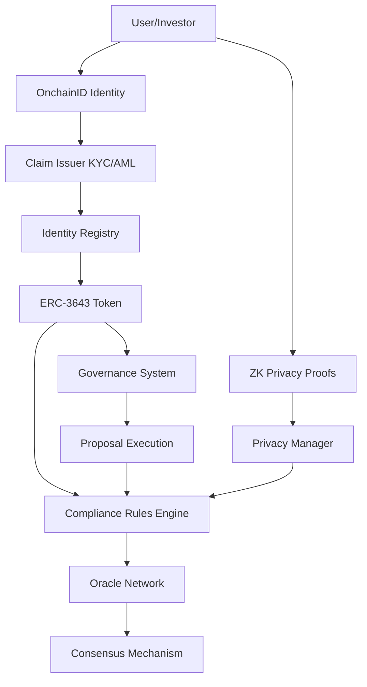

# Technical Deep Dive: the transfer path

How a VSC transfer is checked: the token, ComplianceRules, the oracle
consensus that writes the lists, and the security notes for that path.
Checked against the code in Task 5.5 and again at 8c77e24 (2026-10-20);
listings are condensed from the Solidity named next to each.

The technical deep dive is three files: [transfer path](DEEP_DIVE_TRANSFER.md) (token, compliance, oracles), [identity, recovery and governance](DEEP_DIVE_IDENTITY.md) and [zero-knowledge circuits](DEEP_DIVE_ZK.md).

---

## 🏗️ Architecture Deep Dive

### System Integration Flow



---

## 🎫 ERC-3643 Token Implementation

### Transfer checks (`Token.sol`)

There is no `_transfer` override. `transfer` and `transferFrom` carry
`whenNotPaused` and `whenNotFrozen(sender)` and run `_checkTransferFull`,
which returns the first failing reason; `canTransfer` returns the same
verdict as a bool.

```solidity
function transfer(address _to, uint256 _amount) public override whenNotPaused whenNotFrozen(msg.sender) returns (bool) {
    bool fromTrusted = _requireTransfer(msg.sender, _to, _amount); // reverts with _checkTransferFull's reason
    bool success = super.transfer(_to, _amount);
    if (success) {
        _compliance.transferred(msg.sender, _to, _amount);   // empty hook
        _recordTransfer(msg.sender, _amount, fromTrusted);   // cooldown clock, below
    }
    return success;
}
```

`_checkTransferFull(from, to, amount)` for a transfer, in order:

1. `Token paused`, `Sender frozen`, `Recipient frozen`.
2. Unless either side is a contract trusted on this token (escrow, custody
   wallet, governance on VGT): `Sender not verified`, `Recipient not
verified` (`IdentityRegistry.isVerified`). On that trusted path
   ComplianceRules verifies the other party's identity, whitelist and
   country instead.
3. `Insufficient balance` (the free balance: balance minus partially
   frozen tokens).
4. `Compliance check failed` (`ComplianceRules.canTransfer`).
5. With an InvestorTypeRegistry bound: for a non-trusted sender one call,
   `transferCheck(from, amount)`, answers the registry's authorization,
   the sender's per-transfer cap and its cooldown (codes 1/2/3: `Token not
authorized by investor registry`, `Transfer amount limit exceeded`,
   `Transfer cooldown`); a trusted sender is checked for the authorization
   only. Then a non-trusted recipient's `canHoldAmount`: `Holding limit
exceeded`.

A mint checks `Recipient frozen`, `Identity not verified`, `Compliance
check failed`, the authorization and the holding cap. `burn(from,
amount)` is agent only, checks `Insufficient balance` and `Insufficient
free balance` and is never gated by ComplianceRules. After a successful
transfer `_recordTransfer` writes the sender's cooldown clock
(`recordTransfer`) unless the amount is 0 or the sender is trusted.

Pause: the owner or the guardian; unpause: the owner on VSC, the owner or
an agent on VGT. The guardian can pause again after a voted unpause, and a
pause never expires (D56; an audit item).

### Frozen tokens

```solidity
function getFreeBalance(address _userAddress) public view returns (uint256) {
    return balanceOf(_userAddress) - _frozenTokens[_userAddress]; // no guard: relies on frozen <= balance
}

function freezePartialTokens(address _userAddress, uint256 _amount) external override onlyAgent {
    _checkAgentTarget(_userAddress); // VGT: refuses a trusted contract (D23)
    require(balanceOf(_userAddress) >= _frozenTokens[_userAddress] + _amount, "Insufficient balance to freeze");
    _frozenTokens[_userAddress] += _amount;
    emit TokensFrozen(_userAddress, _amount);
}
```

Freezing, the free-balance checks on transfer and burn, and recovery
(which moves balance and frozen amount together) keep `frozen <= balance`.
Token-side wallet recovery (`recoveryAddress`) is described with identity
recovery in [DEEP_DIVE_IDENTITY.md](DEEP_DIVE_IDENTITY.md#token-side-recovery-recoveryaddress).

---

## 🔮 Oracle Consensus Mechanism

### One gate, one engine (plan v2 Task 4.4, D11 = a)

`OracleManager` is the gate. It holds the node registry and lifecycle,
the query registry, and the one vote entry, `submitResponse`. The list
oracles read `isActiveOracle`, `getQueryBinding`, `getQueryData`,
`getQueryResolution` and `getQuerySupport` from it; BlacklistOracle also
reads `isEmergencyOracle`. `ConsensusOracle` is the manager's
weighted engine: it is built for one manager (`constructor(address
manager)`), every write is manager-only, it has no owner, no pause and no
query store of its own. The manager binds it with the owner-only
`setConsensusEngine`, which refuses an address without code or an engine
built for another manager. A manager with no engine opens no query.
Re-binding strands queries open in the old engine (their votes revert
`UnknownQuery`; raise them again), and only the handover ceremony pins
the engine's code hash.

**The rule.** When a query opens, the engine snapshots every REGISTERED
node of the manager, active or paused, with its weight then
(`DEFAULT_ORACLE_WEIGHT`, 100, for a node without a weight), and freezes
the bar, `snapshotWeight * consensusThreshold`. Pausing or parking nodes
therefore never lowers a bar: it can only stop a query resolving (review
M-1; the first 4.4 cut snapshotted the active weight, so pausing two of
three nodes let the third resolve alone). Only snapshot members vote (a
node registered later is refused, `NotInSnapshot`), each with its weight
at open; the manager decides who may vote now (active), so a node paused
at open and unpaused later votes with its snapshot weight. YES resolves
when `yesWeight * 100 >= bar`, NO symmetrically; the threshold is a
percent in (50, 100]. The default, 66, makes two of three equal nodes a
verdict (200 of 300 is 66.7%); a 1-1 split resolves nothing. Weight,
threshold and expiry changes apply to later queries only. Removal or a
weight change (both owner only) changes a later denominator. A query opens
only with at least two registered nodes (`TooFewNodes`) and when no single
node's weight reaches the bar (`SingleNodeQuorum`, Task 5.1). A query expires
`queryExpiryTime` after it opened (1 hour; 10 minutes to 24 hours): later
votes are refused and it closes without a verdict, so a new query must be
raised. Opening writes one storage slot per registered node (up to 100,
`MAX_ORACLES`); its gas is not measured in the repo.

**Opening a query** (`OracleManager.submitQuery`, owner or active
node; a non-zero subject, type 1..4, then `_checkQueryPayload`: R-2F3-2
severity, 4.12 tier 1..5, and a CRITICAL blacklist or tier-5 whitelist
query only from the owner, `SeverityRequiresOwner` / `TierRequiresOwner`):

```solidity
queryId = keccak256(abi.encodePacked(_subject, _queryType, _data, block.timestamp, msg.sender));
_boundEngine().openQuery(queryId); // snapshot; refuses an existing id, < 2 registered nodes, zero weight, or one node at the bar
```

Owner-only CRITICAL and tier 5 restrict who may raise a query. The list
oracles' owner (ops after the handover) and their list manager still write
a CRITICAL or tier-5 entry directly (`addToBlacklist`, `addToWhitelist`),
and a consensus severity sets only the duration (D44 a; the list-oracle
ownership posture is an audit item).

**Answering** (`OracleManager.submitResponse`, an active node):

```solidity
require(query.timestamp > 0, "OracleManager: Query does not exist");
if (query.hasResult) revert QueryAlreadyResolved();
(bool resolved, bool result) = engine.recordVote(_queryId, msg.sender, _result);
oracles[msg.sender].totalAttestations++;
if (resolved) {
    query.hasResult = true;
    query.result = result;
    query.resolvedAt = block.timestamp;                  // set once (R-2F3-1)
    query.support = engine.votersFor(_queryId, result);  // Task 5.1
}
```

**The tally** (`ConsensusOracle.recordVote`, manager only):

```solidity
if (q.openedAt == 0) revert UnknownQuery();
if (q.resolved) revert QueryResolved();
if (block.timestamp >= q.expiresAt) revert QueryExpired();
if (q.hasVoted[voter]) revert AlreadyVoted();
uint256 weight = q.weightAt[voter]; // frozen at open
if (weight == 0) revert NotInSnapshot();
// ... record the vote, add the weight to its side ...
if (q.yesWeight * 100 >= q.bar) { q.resolved = true; q.result = true; }
else if (q.noWeight * 100 >= q.bar) { q.resolved = true; }
```

**Applying a verdict.** A node attests to the Whitelist or Blacklist
oracle (`provideAttestation`, its own signature over subject, queryId,
result and chain id). The oracle binds the queryId to its subject and
type, then applies the manager's resolution once, while fresh and only if
it resolved after the subject's last write (R-2F3-1), and only if at
least `minimumConsensusOracles` distinct nodes (default 2, never below 2)
voted its way (`TooFewVoters`, Task 5.1). A paused node can neither answer
nor attest. `emergencyOverride(oracle, queryId, result, reason)` (owner)
can stamp or flip the verdict of any existing query; `support` is
recounted from the engine's votes when the side changes.

**Signature sets.** `validateOracleConsensus(oracles, signatures, hash)`
adds the engine weights of distinct, active signers whose EIP-191
signature recovers to them and compares the sum with the same threshold
of the live registered weight (pausing nodes never lowers it); it is
false while a single registered node could meet that bar alone.

**Parameters** go through the manager, so governance sets them after the
handover (OracleParameters, type 2): `setConsensusThreshold(percent)`,
`setOracleWeight`, `batchSetOracleWeights`, `setQueryExpiryTime`.

### Node lifecycle

| Action                                                       | Who               | Effect                                                                                                                                                                                                                                                                                                       |
| ------------------------------------------------------------ | ----------------- | ------------------------------------------------------------------------------------------------------------------------------------------------------------------------------------------------------------------------------------------------------------------------------------------------------------ |
| `registerOracle(node, name, description, reputation)`        | owner             | active node, reputation 100-1000                                                                                                                                                                                                                                                                             |
| `pauseOracle(node)` / `unpauseOracle(node)`                  | owner or operator | stops / resumes answering and attesting (the node stays in every snapshot's denominator); the owner pausing an already inactive node adopts the pause; unpause refuses a node at `MIN_REPUTATION` (100), where `penalizeOracle` parks it, and refuses the operator a node the owner paused (`pausedByOwner`) |
| `setEmergencyOracle(node, flag)`                             | owner or operator | the one emergency designation: `BlacklistOracle.emergencyBlacklist` requires it and an active node                                                                                                                                                                                                           |
| `removeOracle(node, reason)`                                 | owner             | offboards the node, clears its designation, resets its engine weight                                                                                                                                                                                                                                         |
| `setOperator(account)`                                       | owner             | the operator role (ops after the handover)                                                                                                                                                                                                                                                                   |
| `rewardOracle` / `penalizeOracle` / `updateOracleReputation` | owner             | reputation, emitted as `OracleReputationUpdated`; engine weights do not follow it                                                                                                                                                                                                                            |

## 🔒 Compliance Rules Engine

### Structure (plan v2 Task 4.1)

`ComplianceRules` is one deployed contract built from three files:
`ComplianceRulesTrust` (abstract: per-token trusted contracts and
code-hash registrars), `ComplianceRulesAdmin` (abstract: every other
setting and its setters) and `ComplianceRules is ComplianceRulesAdmin,
IComplianceHooks` (the evaluation the token calls: `canTransfer`,
`canReceive`, `isTrustedContract`, `whitelistTierAllows`, the empty
`transferred`/`created`/`destroyed` hooks and the `isProductionCompliance`
markers). One address, one governance type (ComplianceRules, type 1), one
ABI.

`canTransfer` applies the blacklist oracle on every path, the whitelist by
mode with the tier rule, the counterparty's identity on the trusted path,
and the jurisdiction rule, and fails closed when no identity registry is
bound for the token. Of the per-investor rules it evaluates only the
jurisdiction rule: the investor-type, holding-period and compliance-level
rules it once stored were removed in Task 4.1 (no transfer read them).
Investor-type limits live in `InvestorTypeRegistry`, which the token reads
on every transfer (`transferCheck`: authorization, "Transfer amount limit
exceeded", "Transfer cooldown"; then `canHoldAmount`: "Holding limit
exceeded") and mint (authorization and `canHoldAmount`). A registry that
has not authorized the token refuses everything ("Token not authorized by
investor registry", R-410-1); the clock is written by `recordTransfer`,
from an authorized token only. ComplianceRules also requires a party's
whitelist oracle entry tier to reach its type's required tier where the
party passes by that entry (`whitelistTierAllows`); in Either mode with a
whitelist oracle bound, a ZK proof alone serves only investor types whose
required tier is 1, and Either with no oracle bound acts as ZkOnly (D46
a); see docs/INVESTOR_TYPE_SYSTEM.md.

### Jurisdiction verdict

`validateJurisdiction(token, country)` returns the verdict `canTransfer`
applies, from one shared function:

```solidity
function _countryVerdict(address token, uint256 country) internal view returns (uint8) {
    if (defaultJurisdictionRule.blockedCountryMap[country]) return 1; // always applies
    JurisdictionRule storage rule = _getJurisdictionRule(token);      // token rule, else default
    if (!rule.isActive) return 0;
    if (rule.blockedCountryMap[country]) return 1;                    // "Country is blocked"
    if (rule.allowedCountries.length > 0 && !rule.allowedCountryMap[country]) {
        return 2;                                                     // "Country not in allowed list"
    }
    return 0;
}
```

The default blocked list (set at construction) applies to every token and
a token rule cannot remove it. `setJurisdictionRule` and
`clearJurisdictionRule` bump `jurisdictionRuleVersion[token]`, which
PrivacyManager folds into its jurisdiction policy hash.

### Per-token trust and administration (G5)

Trusted contracts and rule administrators are kept per token:

- `addTrustedContract(token, account)`: the owner, or a registrar of
  that token for an account whose runtime code hash is the registered one
  (InvestorRequestManager for `MultiSigWallet`, EscrowWalletFactory for
  `MultiSigEscrowWallet`; `setTrustedRegistrar(token, registrar,
codeHash)`, owner only, event `TrustedRegistrarSet`).
  `removeTrustedContract(token, account)`: owner only, never the owner
  itself (D21). Contracts only, never a wallet or an EIP-7702 delegated
  wallet. Trusting governance
  for VGT, where it holds proposal fees, does not trust it on VSC.
- `isTrustedContract(account)` answers for `msg.sender`: Token and
  GovernanceToken call it as the token. Off-chain readers use
  `isTrustedContract(token, account)` and the token-indexed
  `TrustedContractAdded(token, account)` event.
- `canReceive` (wallet recovery) refuses an account trusted on any token,
  so a recovery on one token cannot move a holder's shared identity onto
  a contract trusted on another.
- `setRuleAdministrator(token, account, bool)` (owner) grants the right to
  set or clear that token's jurisdiction rule; the constructor grants
  nobody. After the handover governance holds it for VSC and VGT.

---

## 📊 Gas

The repo measures the transfer path only: `scripts/gas-analysis.ts`
(`npm run gas:claims`) records a baseline and CI fails a rise over 1,500
gas. Re-recorded at dd7943f (Task 5.17): 96,916 with the permissive mock
registry (A), 144,222 with one claim topic (B), 177,332 with KYC and AML
(C), 105,954 with both identities in the verification cache (D), 135,290
with an authorized InvestorTypeRegistry too (E); `refreshVerified` 103,060. No
figure for identity creation, claims, attestations, ZK verification or
votes is measured in the repo.

## 🔍 Security Considerations

### Invariants

1. **Supply:** `totalSupply() == Σ balanceOf(a)` (OpenZeppelin), and for
   every holder `frozenTokens(a) <= balanceOf(a)`: frozen tokens are part
   of the balance.
2. **Identity binding:** IdentityRegistry maps each wallet to at most one
   identity ("Identity already registered") and each identity to at most
   one wallet ("Identity already bound", `walletOf`). One identity per
   person rests on the KYC issuer and the registry agent, off chain; the
   factory can re-point `ownerToIdentity`, so it is not an invariant.
3. **Consensus:** for every query `yesWeight + noWeight <= snapshotWeight`
   (only snapshot members vote, once each, with their weight at open).

### Attack vectors

1. **Sybil:** one vote per registered identity; identities younger than
   `minVoterAge` do not vote; one identity per person is off chain (above).
2. **Proof replay and front-running:** every proof binds the submitting
   wallet (`walletBinding == msg.sender`), so a copied proof is useless to
   another wallet; a nullifier binds one wallet per whitelist root version
   or attestation policy. There is no commit-reveal.
3. **Oracle manipulation:** a weighted threshold over a registered-node
   snapshot, at least two nodes and no single-node quorum, at least two
   distinct supporting voters per applied verdict (Task 5.1). Reputation
   does not weight votes (penalizing a node to 100 parks it). The list
   oracles' owner (ops) writes entries directly, CRITICAL and tier 5
   included (D44 a; an audit item).
4. **Governance:** the proposal cost deters spam; the voting cost is a
   deposit (burned on a pass, claimable on reject or cancel) and does not
   weight votes; the execution delay; the quorum denominator frozen at
   creation; cost setters bounded (at most 1,000 VGT); settlement makes no
   external call, so one unpayable participant cannot freeze the others'
   deposits.
5. **Oracle failure:** ComplianceRules calls the oracles without a
   fallback, so a reverting oracle reverts every transfer (fail closed).
   Unbinding an oracle removes its gate until a working one is rebound:
   with no blacklist oracle nobody is sanctions-checked; OracleOnly with
   no whitelist oracle passes every party; Either with no whitelist oracle
   falls back to the ZK binding alone. The remedy is rebinding a working
   oracle (or pausing the token), not unbinding.

### Not done

Formal verification of the circuits (not started); an external security
audit; a testnet deployment (the Sepolia rehearsal, Task 5.8; the
deploy tooling is built, Tasks 5.7 and 5.15).
